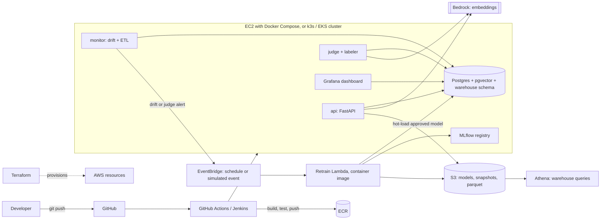

# TicketTriage: full project vision

## 1. Idea in one paragraph

TicketTriage is a support-ticket routing service that **maintains itself**. It classifies each
ticket into an intent, logs the ticket's embedding and prediction, estimates its own accuracy
in production with an **LLM judge** (no live labels needed), detects when quality or the data
distribution drifts, selects the most informative new tickets using **vector search**, gets
them labeled by an LLM and audited by the judge, retrains a small model, and deploys the new
version **only if it passes an evaluation gate**. The whole loop is containerized, deployed
from Git by CI/CD, and observable through a data warehouse and dashboard on AWS.

## 2. Goals

1. Show the complete MLOps lifecycle: develop, version, deploy, monitor, retrain, govern.
2. Treat the **vector database as the training-data store**, not just a search feature.
3. Use LLMs where they are strong (labeling, judging, paraphrasing) and a small trained
   model where it is cheap, fast and measurable (classification).
4. Make every claim measurable: validate the judge against ground truth, compare data
   selection strategies, and report cost and latency alongside accuracy.
5. Keep the system reproducible: one command to build, deploy and tear down.

## 3. Architecture



### Components

| Component                  | Role                                                              | Tier                                                                  |
| -------------------------- | ----------------------------------------------------------------- | --------------------------------------------------------------------- |
| `api` (FastAPI)            | Embeds a ticket, predicts intent and confidence, logs everything  | Core                                                                  |
| `db` (Postgres + pgvector) | Vectors, labels, prediction logs, plus the `ops` and `dw` schemas | Core                                                                  |
| `worker` / `monitor`       | Drift statistics, ETL from `ops` to `dw`, retrain triggers        | Core (single worker); split into `monitor` + `judge` in the extension |
| `judge` + labeler          | LLM-as-judge on sampled traffic, LLM labeling with judge audit    | Core                                                                  |
| Retraining job             | Pulls vectors from Postgres, trains, runs the evaluation gate     | Core as a Docker job; **Extension:** Lambda container image           |
| Dashboard                  | KPIs and drift over time                                          | Core (one tool: Grafana or Streamlit)                                 |
| GitHub Actions             | Test, lint, build, push to ECR, deploy over SSH                   | Core                                                                  |
| S3 + ECR                   | Model versions, snapshots, images                                 | Core                                                                  |
| MLflow                     | Experiment tracking and model registry                            | Extension                                                             |
| Terraform                  | All AWS resources as code, one-command teardown                   | Extension                                                             |
| Ansible                    | Provision the host and deploy Compose                             | Extension                                                             |
| Jenkins                    | Same pipeline as a `Jenkinsfile`, compared with Actions           | Extension                                                             |
| EventBridge + Lambda       | Scheduled and simulated-event retraining                          | Extension                                                             |
| Athena over S3 Parquet     | Second warehouse path alongside Postgres                          | Extension                                                             |
| k3s, then EKS for the demo | Orchestrated deployment, rolling update and rollback              | Extension                                                             |
| Step Functions             | Visual orchestration of label, retrain, gate, deploy              | Optional                                                              |

## 4. The lifecycle loop

1. **Serve:** the api embeds the ticket, predicts, returns intent plus confidence, and logs the
   vector, prediction and model version.
2. **Observe:** the monitor loads logs into the warehouse and computes drift statistics
   (population stability index or a KS test on confidence, plus distance between current and
   training embeddings).
3. **Judge:** a sample of traffic, plus every low-confidence ticket, goes to an LLM judge that
   returns `correct`, `suggested_intent` and a one-line `reason`. Estimated accuracy is stored
   per batch.
4. **Trigger:** retraining starts when rolling judge accuracy or the drift score crosses a
   threshold. The trigger is configurable: `drift`, `judge`, `volume`, `schedule` or `manual`.
5. **Select:** pgvector picks the tickets worth labeling: low confidence, far from the training
   centroids, or members of a cluster of unrouted tickets.
6. **Label and audit:** an LLM labels them. A second pass (the judge) audits the labels, and
   only labels where both agree are kept. For clusters that match no known intent, the LLM
   proposes an intent name and a human approves it.
7. **Retrain:** the job trains on old plus new vectors read from Postgres.
8. **Gate:** the candidate is deployed only if it passes the evaluation gate (section 6).
9. **Deploy and roll back:** the api hot-loads the approved version from S3 (or a rolling
   update on the cluster). A failed health check rolls back to the previous version.

## 5. Data and simulation

- **Dataset:** the Bitext customer-support dataset (27 intents), CDLA-Sharing 1.0, attribution
  required.
- **Launch vs future intents:** about 75% of intents train the first model. The rest stay hidden
  until the new-intents stage.
- **Splits:** `train / val / test / stream`. `test` is frozen for the gate. `stream` is replayed
  as simulated production traffic in time-ordered batches.
- **Drift stage 1, style shift (Core):** an LLM paraphrases stream tickets (shorter, typos,
  angry tone, mixed formality). The data is synthetic, and the report says so.
- **Drift stage 2, new intents (Extension):** tickets from future intents arrive. The model has
  never seen these classes, so confidence drops, clusters of unrouted tickets appear, and the
  label set grows after retraining.
- **Honest framing:** drift is simulated, and ground-truth labels exist but are hidden from the
  live system. They are used only to validate the judge and to compute true accuracy for the
  evaluation.

## 6. Evaluation gate

A candidate model is promoted only if **all** of these hold (thresholds live in config):

1. Macro-F1 on the frozen test set is not worse than the current model.
2. Accuracy on a holdout from the **latest batch** improves by at least a margin.
3. No individual intent's F1 drops by more than a set amount (no silent regressions).
4. Judge-estimated accuracy on a sample is not worse.
5. Model size and p95 latency stay within limits.

Every decision, pass or fail, is written to the warehouse with the metrics behind it.

## 7. LLM-as-judge design

- **Input:** ticket text, predicted intent, and short definitions of every intent.
- **Output:** strict JSON (`correct`, `suggested_intent`, `reason`). Temperature 0, intent list
  order shuffled per call to reduce position bias.
- **Versioned prompts:** `judge/prompts/vN.md`, treated like code. Changing the prompt changes
  the metrics, so each warehouse row records the prompt version.
- **Sampling:** about 10% of traffic plus all low-confidence tickets.
- **Validation (the credibility step):** run the judge on tickets with known labels and report
  agreement with ground truth (accuracy, Cohen's kappa, per-intent breakdown), on the baseline
  set and again on the shifted batches.
- **Known limits to discuss:** position and self-preference bias, ambiguity between similar
  intents, and shared blind spots if the labeler and judge use the same model family. Use
  different prompts, and different models where the region allows.
- **Uses:** production accuracy estimate, retrain trigger, label audit, and a secondary signal in
  the gate. The primary gate metric stays ground-truth macro-F1 on the frozen test set.

## 8. Data warehouse

A star schema in the `dw` schema of Postgres, with the same tables mirrored to Parquet in S3
and queried by Athena in the extension.

| Table                                                      | Type       | Grain / purpose                                                          |
| ---------------------------------------------------------- | ---------- | ------------------------------------------------------------------------ |
| `fact_prediction`                                          | fact       | one row per prediction: intent, confidence, latency, model version       |
| `fact_judgment`                                            | fact       | one row per judged prediction: verdict, suggested intent, prompt version |
| `fact_label`                                               | fact       | one row per newly labeled ticket: labeler output, audit agreement        |
| `fact_model_eval`                                          | fact       | one row per candidate model: gate metrics and pass/fail                  |
| `dim_date`, `dim_intent`, `dim_model_version`, `dim_batch` | dimensions | slicing and joins                                                        |

**KPIs:** judge-estimated accuracy, auto-route rate, escalation rate, drift score, label
agreement rate, cost per 1,000 tickets, p95 latency, time from drift alert to deployed model.

**Business recommendation output:** clusters of unrouted tickets become proposed new intents or
teams, with volume estimates, as a recommendation for the report.

## 9. Infrastructure

- **Core:** one EC2 instance running Docker Compose, S3, ECR, Bedrock, IAM, deployed from
  GitHub Actions. Created by hand, documented in [docs/AWS_SETUP.md](docs/AWS_SETUP.md).
- **Extension:** Terraform for everything (S3, ECR, IAM, VPC pieces, EC2, Lambda,
  EventBridge), Ansible for host setup and deploys, a k3s cluster with manifests in `k8s/`, and
  EKS only for the final demo.
- **Networking rule:** avoid a NAT gateway. Bedrock calls stay on the EC2/cluster side. A
  Lambda that must reach Postgres sits in the VPC and uses an S3 gateway endpoint.
- **Security:** least-privilege IAM roles per component, GitHub OIDC instead of stored keys,
  secrets in Secrets Manager or SSM Parameter Store, the database never exposed publicly.

## 10. Experiments for the report

| #   | Question                                             | Measure                                                                            |
| --- | ---------------------------------------------------- | ---------------------------------------------------------------------------------- |
| E1  | Does retraining recover accuracy after drift?        | Accuracy per batch before and after each retrain                                   |
| E2  | Which selection strategy is best per labeled ticket? | Random vs low-confidence vs vector-cluster selection, accuracy recovered per label |
| E3  | Can the judge be trusted?                            | Agreement and kappa vs ground truth, per intent                                    |
| E4  | How good are LLM labels?                             | Label accuracy vs ground truth, and effect of the judge audit                      |
| E5  | Retrained small model vs zero-shot LLM classifier    | Accuracy, latency, cost per 1,000 tickets                                          |
| E6  | Containers vs VMs                                    | Startup time, memory overhead, image size                                          |
| E7  | Rollout safety                                       | Time to roll back a bad model, and gate catch rate on a deliberately bad candidate |

## 11. Repository layout (full)

```
src/tickettriage/
  api/            FastAPI service
  train/          baseline + retraining + gate
  retrain_lambda/ Lambda handler and Dockerfile
  monitor/        drift statistics, ETL
  judge/          judge, labeler, audit
  replay/         traffic simulator, paraphrase generator
judge/prompts/    versioned prompts
warehouse/        schema.sql, views, Parquet export
k8s/              manifests (extension)
infra/            terraform/, ansible/ (extension)
ci/               Jenkinsfile (extension)
docker/           one Dockerfile per service
docs/             plans, AWS setup, report, diagrams
```

## 15. Risks

- **Scope creep:** the biggest risk. Finish and measure Phase A before starting anything else.
- **Judge unreliability:** mitigated by validation against ground truth and versioned prompts.
- **Templated data:** very high baseline accuracy. Report drift results, not the baseline.
- **Embedding drift of the tooling itself:** never mix vectors from different embedding models.
- **Cost surprises:** idle EC2, a forgotten EKS cluster, a NAT gateway, judging every request.

## 16. Possible future directions

- True fine-tuning of a small transformer (for example LoRA) once GPU budget exists.
- Multi-label and hierarchical intents.
- A human review UI for low-agreement labels.
- Active-learning research: formal comparison of embedding-based selection methods on a
  larger, real (non-templated) ticket corpus.
